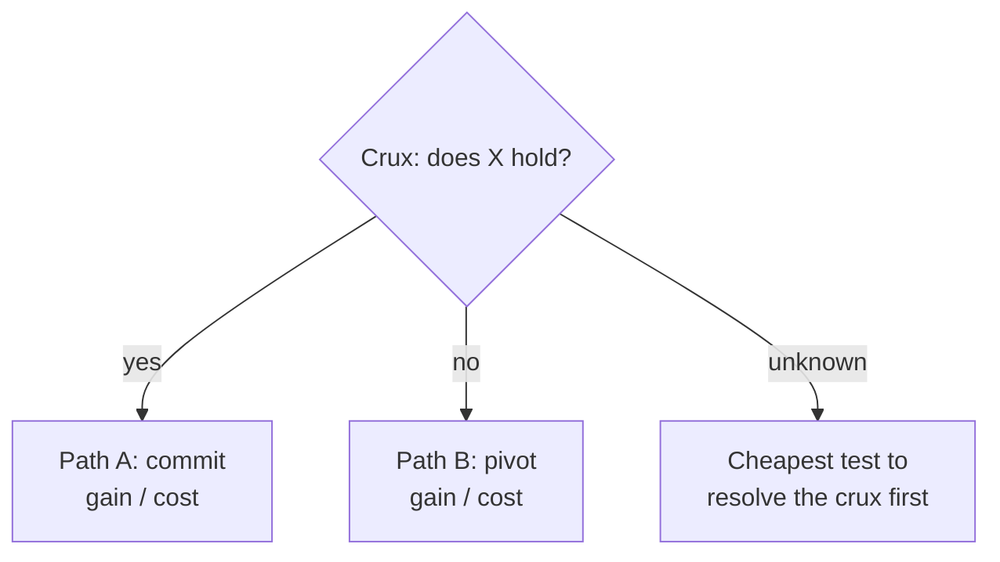

# Dream — explore a concept, then hand back a direction

Most "analysis" ends by describing the situation more precisely and leaving the
person exactly where they started: clearer, but still unsure what to *do*. Dream
does not stop there. It runs to a **direction** — a recommended path, sequenced,
with the first concrete move named — and it leaves behind an artifact, not just a
conversation.

Four things separate a dream from a summary, and all four are mandatory:

1. It **researches before it reasons**, and keeps the evidence.
2. It analyses the **human/psychological** reality, not only the mechanics —
   especially for anything involving a market, customers, a team, or adoption.
3. It **draws** the decision — a tree, a branch map, a comparison — because a
   decision with three live paths is not a paragraph, it is a shape.
4. It **auto-saves** the full exploration as a structured document and ends by
   telling the person what to do next. No separate command to remember; saving is
   part of the run.

`$ARGUMENTS` is the concept, idea, or decision, optionally followed by
`--lens <names>` to fix the angles. If no lens is given, infer the ones that
actually apply. For anything with humans on the other side of it — a business
model, a product, a policy, a pricing change — **psychology is in scope by
default**; drop it only if the concept is purely mechanical.

This is not a template. A finding that would read the same for any concept has
failed. Every line must be specific to *this* concept or it does not belong.

---

## Phase 0 — Frame it precisely

Ambiguity here poisons everything after it.

1. Restate the concept in one sharp sentence. If you cannot, that is the first
   finding: it is not yet clear enough to evaluate — sharpen it with the user.
2. Name the **decision** this informs ("should I build X", "is Y worth pursuing",
   "which of A/B"), and who has to live with it. If it is pure exploration, say so.
3. Select the lenses that genuinely apply and say why each is in or out:
   - **mechanism** — how it actually works, from first principles
   - **viability** — is it sound, or does it collapse under its own assumptions
   - **persistence** — can it last, and under exactly what conditions
   - **branching** — the genuinely different paths it opens
   - **trade-offs** — what each path gains and costs, including the irreversible
   - **psychology / human** — how real people *feel* and *behave* around it
     (see Phase 2; for business, this is the deep one, not a footnote)
   - **creative** — the reframing, the 10x-simpler version, the adjacent idea

---

## Phase 1 — Ground it in reality (research first, and keep it)

Reason *after* you know, not instead of knowing. Speculating about the knowable is
the failure mode.

- **Prior art and precedent.** Has this, or something close, been tried? What
  happened, and why? Use `cc research <topic>` for technical/scientific concepts
  (real arXiv retrieval) and web search for market, competitor, adoption, and
  precedent signals.
- **The numbers**, if it is quantitative — market size, unit costs, adoption and
  failure rates of the category, churn, price points.
- **The human signal** — for a business/product concept, actively look for how
  people *react*: reviews, complaints, why comparable things were abandoned or
  loved, what people say when they churn. This feeds the psychology lens with
  evidence instead of armchair guesses.
- **Cite.** Separate **fact** (with a source) from **inference** (your reasoning)
  explicitly, and never dress one as the other.
- If research turns up little, say so — absence of prior art is information
  (genuinely novel, or nobody found it worth doing; which one matters).

**Keep a real research record, not a summary.** As you go, build `research.md`
(saved verbatim in Phase 4) to a genuine depth — it is the evidence the whole
exploration rests on, and a thin one is the tell that the analysis is guessing:

- **One entry per source**, each with the claim, the **specific number or quote**,
  and the source name/URL — not a paragraph that blends five sources into a vibe.
- **Name the precedents concretely.** Not "some companies use hybrids" but *which*
  ones, *what* they charge, and *what happened* (e.g. "JetBrains: subscription +
  perpetual-fallback since 2015, bootstrapped to $400M"; "Sublime: $99 perpetual
  individual, business seats annual"). Concrete cases are what let the reader
  transfer the lesson to their own situation.
- **Separate FACT (sourced) from INFERENCE (your reasoning)** in two clearly
  labelled sections. Never let one wear the other's clothes.
- **Depth scales with stakes.** A quick concept may need a handful of sources; a
  business or irreversible decision warrants going until the findings *converge or
  contradict* — a couple of searches that only skim the surface is not enough, and
  saving that thin record is the failure the user will notice.
- If a claim matters and you could not source it, say so explicitly rather than
  quietly dropping it — a known gap is worth more than a confident blank.

---

## Phase 2 — Explore across the selected lenses

Go deep on *this* concept. Each lens below is a way in, not a box to tick.

- **Mechanism** — walk how it works step by step. Locate the load-bearing
  assumption: the one thing that, if false, sinks it. Most ideas die here.
- **Viability** — build the strongest case FOR, then the strongest case AGAINST.
  Steelman before you red-team; a red-team of a strawman is worthless.
- **Persistence** — if it lasts, *why* and *where*: what moat, what conditions
  must hold, what compounds. If it does not, *what specifically kills it* and
  *when* — a competitor, the unit economics, a platform dependency, a regulation.
  Conditional, not a verdict.

### The psychology / human lens — do this properly

For anything with people on the other side, the mechanics can be perfect and the
thing still fails, or be crude and still win, because of how humans actually
behave. Analyse the concept through real behavioural forces — name the ones that
genuinely bear on *this* concept and show how, don't recite the list:

- **Motivation & jobs-to-be-done** — what emotional job does this really do for
  the person? People buy relief, status, identity, belonging, safety, time — rarely
  the feature you built.
- **Loss aversion & the endowment effect** — switching *away* from what they have
  feels like a loss worth ~2x the equivalent gain. What are you asking them to give
  up, and does your upside clear that 2x bar?
- **Friction, effort & the status quo** — every extra step sheds users. What is the
  real activation cost (cognitive, not just clicks)? Defaults and inertia usually
  beat "better."
- **Trust, risk & social proof** — what must they believe, and who do they need to
  see using it first? Where does distrust concentrate (money, data, reputation)?
- **Identity & social signalling** — does using it say something they want said
  about them, or something they'd rather hide?
- **Habit & reward timing** — does the payoff land soon enough, often enough, to
  form a habit? Delayed or uncertain reward kills otherwise-good products.
- **Who resists, and why** — name the humans who lose from this (a team whose
  workflow changes, an incumbent's champion, a role it deskills) and how that
  resistance shows up.

Ground each claim in the Phase 1 human signal where you can. The output of this
lens is not "people might not like it" — it is *which specific behaviour, driven by
which force, helps or sinks this concept, and what would change it.*

- **Branching** — the two or three genuinely different paths this opens. Real
  forks, not variations of one plan. Where does each lead in a year, in five?
- **Trade-offs** — for each path: what you gain, what you lose, what you cannot
  undo. Make the cost explicit *before* it is paid.
- **Creative** — the reframing that changes the game, the version with half the
  moving parts, the adjacent concept you would never reach by grinding forward.

---

## Phase 3 — Draw the decision, then choose a direction

Two deliverables here, and neither is optional.

### 3a. Draw it

A decision with several live paths is a shape, not prose. Render the one that fits,
in a fenced ```mermaid``` block (it renders in the doc and in most viewers), or a
clean ASCII tree if the structure is small:

- **Decision tree** when the choice branches on conditions — *if the crux resolves
  this way, take path A; if that way, path B.* Put the crux at the root.
- **Branch/outcome map** (`graph TD`) when paths diverge over time — show where
  each leads at 1 year and 5.
- **Comparison table** for trade-offs across paths (gain / cost / irreversible /
  must-be-true).
- **Force diagram** for the psychology — what pulls adoption forward vs. what
  holds it back, weighted.

Pick what actually clarifies. A diagram that just re-states the text is noise; a
diagram that lets the user *see* the fork is the point.

Example of the shape (adapt entirely to the concept — never ship this literally):



### 3b. Choose a direction

This is the part that makes it worth running. Not a neutral map — a **recommended
path** and the reasoning that got you there:

- **The crux** — the single question that most determines whether this is worth
  pursuing. Everything else is secondary to it. Name it.
- **The recommended path**, with its conditions ("do A *if* the crux resolves
  yes; otherwise B"). If the honest answer is "resolve the crux before committing
  either way," say that — it is a direction, not a dodge.
- **Next actions — sequenced and concrete.** The literal first move (this week),
  then the next. The cheapest experiment, customer conversation, or prototype that
  resolves the crux — with what result would change the recommendation.
- **Strongest and weakest points** of the whole idea, plainly, and **what you'd
  need to know** that you don't.

The test for this phase: could the user get up from the table and *do the first
thing* without asking you a follow-up question? If not, it is not yet direction.

---

## Phase 4 — Persist automatically

Saving is part of the run, not a command the user remembers. Do it every time.

1. Assemble the full exploration into one Markdown document, in this order:
   frame → research (with sources) → lens analysis (psychology included) → the
   diagram(s) → the decision map → the recommended path and sequenced next
   actions. This is a document meant to be reread and acted on, so write it as one.
2. Write it to a temp file, write the raw Phase 1 findings to a second, and archive
   both with the automation, which slugs, timestamps, and indexes them:

```bash
# exploration.md and research.md written to a scratch dir first, then:
cc dream-doc save \
  --concept "<the concept>" \
  --exploration <path-to-exploration.md> \
  --research     <path-to-research.md> \
  --crux   "<the one-line crux>" \
  --lenses "mechanism,psychology,viability,branching" \
  --action "<the literal first next step>"
```

   It stores them under `~/.claude/dreams/<date>-<slug>/` and adds a line to the
   index, so `cc dream-doc list` shows every exploration with its crux and its next
   action, and `cc dream-doc show <slug>` reprints one. A project accumulates a
   decision history instead of scattered one-off answers.
3. Also drop the one-line crux-and-direction into the memory palace, so a later
   session recalls it in context:

```bash
cc remember decisions "<concept>: <crux> -> <recommended direction>"
```

4. Tell the user where it was saved and **restate the single next action**, so the
   run ends pointing at something to do.

If the concept plainly warrants a richer visual report (a business case with
several diagrams the user will share), offer to publish it as a formatted HTML
document in addition to the Markdown — but the Markdown save above always happens.

---

## The bar

- Specific to this concept, always. Generic observations are noise.
- Grounded where factual; cite, don't speculate about the knowable. The saved
  `research.md` is detailed and per-source — named precedents with real numbers,
  not a thin summary. A shallow research record fails the run on its own.
- Psychology treated as evidence-backed analysis, not vibes — for business, it is
  the deep lens, not a closing remark.
- Ends in a **direction** with a concrete first move, not a neutral summary.
- Drawn, not only written, wherever a shape clarifies the choice.
- Saved automatically, every run, so the thinking becomes an asset.
- Honest about uncertainty — name what you don't know rather than confabulate.
- Non-obvious — if the whole output is what the user knew walking in, it failed.
